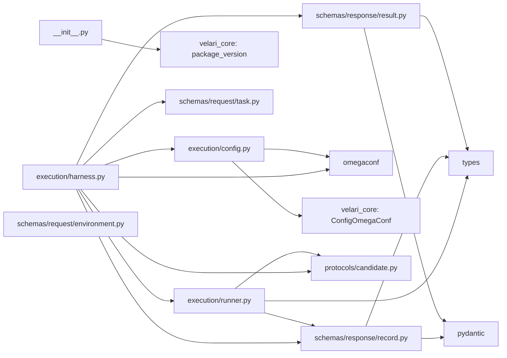
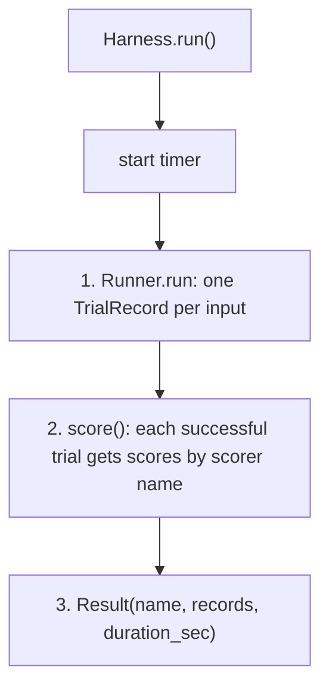

# velari-harness architecture

Matches `velari_harness` as of stage 2, increment 9 (uncommitted at the time of writing). Update it when an increment changes behavior. It describes the code that exists; planned components are in [../plan/](../plan/plan.md) and marked **Planned** in the [glossary](../glossary.md#component-glossary). Statements marked *verified* were checked by running the code; anything else is read from the source.

Audience: contributors who extend or review the harness core. Definitions of terms live in the glossary and are not repeated here.

## 1. Scope

Today the package provides these things. A `Harness`: the container for one measurement, which holds a task, a candidate and optional scorers and whose `run()` chains three steps (run the candidate on every input, score each successful trial, package a serialisable `Result`). The `Candidate` contract: the thing being measured, with a function wrapper. A `Runner` that runs a candidate over a sequence of inputs and returns one `TrialRecord` per input. A `Task`: a named, versioned, immutable set of inputs (and optional references) that says nothing about who is measured. Scorers as plain functions. An `Environment`: the base seed, with a repeatable seed derived for each trial; nothing reads it yet.

Not implemented: cases, datasets, metrics and reducers, repeated trials, a registry, a result store, tracking, an output directory, retries, limits. The core does not seed global random state.

## 2. Components and dependencies

| Module | Responsibility |
|---|---|
| `__init__.py` | `__version__` (from installed metadata via `velari-core`) and the package `logger` |
| `core/schemas/types.py` | `Status` (`SUCCESS`, `ERROR`): how a run or one trial ended; `ReasonCode` (`INVALID_INPUT`, `NOT_FOUND`, `PERMISSION_DENIED`, `TIMEOUT`, `UNAVAILABLE`, `UNEXPECTED`): why a trial failed, by cause. `core/errors.py` has `TrialError`, which a candidate raises to declare its own code |
| `core/schemas/response/record.py` | `Outcome` (`output`, `failure`, `duration_sec`, derived `status`) and `Failure(error, reason_code)` with the exception-to-reason-code rules; `TrialRecord(index, input, outcome, scores)`: what one trial produced |
| `core/schemas/response/result.py` | `Result(name, records, duration_sec)`: one record per task input in order, with computed `trials` (a count per status) and `scores` (the mean per scorer) |
| `core/execution/config.py` | `HarnessConfig` (`name`) and building it from OmegaConf (frozen dataclass, checked at construction) |
| `core/schemas/request/task.py` | `Task`: name, inputs, version and optional references of what is measured (frozen dataclass) |
| `core/schemas/request/environment.py` | `Environment`: the base seed and repeatable per-trial seeds (frozen dataclass) |
| `core/protocols/candidate.py` | `Candidate` (protocol with a per-trial lifecycle) and `CallableCandidate` |
| `core/execution/harness.py` | `Harness`: holds a task, a candidate and scorers; `run()` chains run, score and package; `score()` scores records; `for_task()` builds one |
| `core/execution/runner.py` | `Runner`: runs a candidate over inputs, one trial each, and records the outcome; it does not score |

Field-level detail is in the source docstrings and the glossary, not here. Subfolders have no `__init__.py`.



`protocols/candidate.py` imports only the standard library; only `runner.py` imports it. `harness.py` imports `runner.py`, `Task`, `Candidate`, `TrialRecord` and `Result`; the Runner does not import `harness.py`. `schemas/request/task.py` and `schemas/request/environment.py` import only the standard library and nothing imports them yet.

`velari-ai` and `pandas` are declared in `pyproject.toml` but not imported (*verified* by grep).

Folder convention: within `core/`, a folder imports only from folders to its left in `schemas` <- `protocols` <- `execution`. Nothing enforces it (no lint rule or test); it holds because the package is small. Imports inside the package are relative; imports of other packages are absolute.

## 3. Behavior



A task run has no run-level status or failure. A trial that raises (in `setup`, `run` or `teardown`) is recorded as an `ERROR` outcome and the run carries on, and a scorer that raises gives `None`. Only a `BaseException` (`KeyboardInterrupt`, `SystemExit`) or a bad argument stops a run: the candidate's `teardown` still runs, then the exception propagates and no `Result` is returned. `duration_sec` is measured with `time.perf_counter()` around the three steps; there are no retries, limits or timeouts.

### What holds, and how it is enforced

| Guarantee | Enforced by | Limit |
|---|---|---|
| A trial's `Exception` becomes an `ERROR` outcome and the run carries on | `try/except Exception` in `Runner._trial`; tests | A `BaseException` stops the run and the earlier records are lost |
| The first failure in a trial is the one reported | code; test | |
| `HarnessConfig.name` is a non-empty string, and the config cannot change | `__post_init__` (`TypeError`, `ValueError`); a frozen dataclass; tests | Other fields a subclass adds are not type-checked |
| `Outcome.duration_sec >= 0` and `Result.duration_sec >= 0` | pydantic `Field(ge=0)` | At construction only; pydantic does not validate on assignment |
| `Result` round-trips through JSON | test | Only for JSON-serialisable outputs and inputs |
| The core never seeds global RNG | absence in the code; a test for `Environment.seed_for` | No test for the other modules |
| A trial's seed is the same on every run, in any process | SHA-256 derivation; a pinned-value test | Nothing passes the seed to a candidate yet |
| A candidate's `teardown` runs after a failed `setup` or `run`, including `BaseException` | `try/finally` in `Runner._trial`; tests | |
| A failed trial is never scored, and a scorer that raises is `None`, never a zero | `Harness.score`; tests | |

### Task

`Task(name, inputs, version="1", references=())` is a frozen dataclass. An empty `name` raises `ValueError`; `references` (the expected value per input) is empty or one per input, else `ValueError`; `inputs` and `references` (any sequences) are stored as tuples, so later changes to the list that was passed in do not reach the task; assigning to a field raises `FrozenInstanceError`. All covered by tests in `test_task.py`, together with the central property: one task, run through the Runner against two different candidates, gives each its own outputs. The task knows nothing about either.

### Scorer

A scorer is a plain function `fn(output, reference)` returning a number (a `bool` counts as 1.0 or 0.0), named by its `__name__`; the functions in `velari_ai.ai.evals` (`exact_match`, `edit_distance`) work as they are. `Harness.score(records)` applies every scorer to each `SUCCESS` record and returns copies with `scores` filled in (a `Dict[str, Optional[float]]` by scorer name). A failed trial has no scores, because it has no output to judge. A scorer that raises gets `None` (logged at `ERROR`), never a zero, and later trials still run. Scorers without references, and duplicate scorer names, raise `ValueError` when the harness is built. The candidate never receives a reference. `Result.scores` is the mean per scorer over its non-`None` values. Covered by the scoring cases in `test_harness.py` and `test_result.py`.

### Environment

`Environment(seed=42)` is a frozen dataclass; a `seed` that is not an `int`, or is a `bool`, raises `TypeError`. `seed_for(key, trial=0)` returns `sha256("{seed}:{key}:{trial}")` reduced to `[0, 2**32)`. Covered by tests in `test_environment.py`: pinned values (so the derivation cannot change silently), identical results for identical arguments, a different result when the seed, key or trial changes, the 32-bit range, and global random state left untouched. The values are the same under a different `PYTHONHASHSEED` (*verified*), because SHA-256 is used rather than `hash()`. `1` and `"1"` give the same seed (*verified*), since the key goes through `str`.

### Harness

`Harness.for_task(task, candidate, scorers=[...])` builds a harness named after the task (a `name` override wins). `run()` reads top to bottom as three steps: `Runner().run(candidate, task.inputs)`, `self.score(records)`, then `Result(name, records, duration_sec)`. `Result.trials` counts the trials per status, so a run where every trial failed is visible. There is no harness-level `setup` or `teardown`: the candidate's lifecycle runs once per input inside the Runner. `score()` is public so records can be scored again. Covered by the `TestHarness` class in `test_harness.py`.

### Runner

`Runner().run(candidate, inputs)` returns one `TrialRecord` per input, in order; it only runs the trials and never scores them. For each input it runs `candidate.setup()`, `candidate.run(input)` and `candidate.teardown()` (the lifecycle runs once per input). Outcomes, each covered by a test in `test_runner.py`:

| Case | Candidate calls | Record `outcome.status` | `outcome.output` | `outcome.failure.error` |
|---|---|---|---|---|
| Everything succeeds | `setup`, `run`, `teardown` | `SUCCESS` | what `run` returned | `None` |
| `run` raises on one input | all three; later inputs still run | `ERROR` | `None` | `ValueError: ...` |
| `setup` raises | `setup`, `teardown` (no `run`) | `ERROR` | `None` | `RuntimeError: setup failed` |
| `teardown` raises after success | all three | `ERROR` | what `run` returned | `OSError: teardown failed` |
| `teardown` raises after `run` raised | all three | `ERROR` | `None` | the `run` error (first failure wins) |
| `KeyboardInterrupt` in `run` | `setup`, `run`, `teardown`, then it propagates | no records returned | | |
| No inputs | none | empty list | | |

One `ERROR` log line is written per failed trial. There are no limits, timeouts or retries, and trials are sequential.

## 4. Configuration flow

```
Harness.for_task(task, candidate, cfg, **overrides)
  -> HarnessConfig.from_config(cfg, defaults={"name": task.name}, **overrides)
       ConfigOmegaConf().resolve()                  registers the as_tuple resolver (process-wide, idempotent)
       OmegaConf.to_container(cfg, resolve=True)    {} when cfg is None
       HarnessConfig(**{**defaults, **cfg_fields, **overrides})
  -> cls(config, task, candidate, scorers)
```

- **Precedence:** explicit overrides, then `cfg`, then defaults (the task name for `name`).
- **What `cfg` is:** exactly the harness's own section, holding only `HarnessConfig` fields (just `name`). A root config with sibling sections fails (*verified*): `TypeError: HarnessConfig.__init__() got an unexpected keyword argument 'harness'`. Callers must select the section first.
- **Errors:** non-mapping `cfg` raises `TypeError`; an unknown field raises `TypeError` (message is Python's, not specific to the harness); an empty `name` raises `ValueError`.
- **Types.** `HarnessConfig` is a frozen dataclass that checks `name` at construction: a non-`str` raises `TypeError`, an empty one `ValueError`, before anything runs. Other fields a subclass adds are not type-checked, and a subclass must also be a `@dataclass(frozen=True)`.
- **Related to** `ModelDriver.from_config` in `velari_ai` (`None` means defaults, overrides win), but not identical: this one takes a `defaults` argument at the config level, and it has no seed (the seed lives in `Environment`).

## 5. Extension

The extension points are the things a harness holds, not subclasses of it: write a `Candidate` (`run(input)` is required, `setup()` and `teardown()` optional; `CallableCandidate(fn)` wraps a plain function), a scorer function, or a `Task`. The caller owns the order `setup`, `run`, `teardown` and must call `teardown` even when `run` raised; the Runner does exactly that. To add settings, define a frozen `HarnessConfig` subclass and pass an instance to the harness's constructor (`for_task` builds only a plain `HarnessConfig`). To run candidates without a harness, use `Runner().run(candidate, inputs)`.

## 6. Design decisions

| Decision | Why | Alternative not taken | Cost |
|---|---|---|---|
| `Result` and `TrialRecord` each hold one shared `Outcome`, with one `Failure` | The two said the same thing twice (output or failure, plus a duration), and the reason-code rules lived only in the Runner | Nested `Outcome` classes inside each model (tried, more classes and a frozen-model workaround); `Outcome` as a base class that `Result` and `TrialRecord` subclass (tried, then composition preferred); separate copies | A trial and a run are the same shape (the setup, work, teardown block itself is still written twice, in `Harness.run()` and the Runner), so a change to one (for example a new field on `Outcome`) reaches both |
| Failures are data: a failed trial is a record, a raising scorer is `None`; nothing is raised | Later runs repeat many trials; one failure should not abort the rest, and the outcome must be recordable | Let exceptions propagate to the caller | Callers must look at `trials` or each record's `outcome.status`: a run where every trial failed still returns its records |
| `Harness` is the container that chains run, score and package; the `Runner` only runs | The roles were unclear: a harness base class with an `execute()` hook and a ready-made `TaskHarness` wrapped the same setup, work, teardown block the Runner wraps per trial, and scoring was hidden in the Runner. Now the harness reads top to bottom and each piece has one job | A generic extension base `Harness` with `execute()` plus a `TaskHarness` (built in increments 1 and 6, removed in increment 9); scoring inside the Runner | No hook for work that is not "candidate over task inputs"; a base class can be added back when a second kind of harness exists. A run no longer has a status of its own |
| Dataclass config, pydantic result | The config is built from OmegaConf and extended by subclasses; the result is serialised and validated, like the `velari_ai` response schemas | One type for both | Two validation regimes: the dataclass checks `name` itself, the pydantic result validates the rest |
| `Candidate` is a `typing.Protocol` with default `setup`/`teardown` and an abstract `run` | Any object with the three methods qualifies without subclassing (*verified* with pyright), and a subclass only has to write `run`; the base class gives the defaults | An `ABC`, as `Harness` is | Defaults are inherited only by explicit subclassing; a structural implementation must define all three methods. The default `setup` and `teardown` have an explicit `return None` body: the repo's IDE checker, `ty`, treats a Protocol method with a docstring-only (or `pass`) body as abstract, which made `CallableCandidate(...)` look like an abstract class being instantiated (pyright did not flag it) |
| `Environment` is a frozen dataclass holding only the seed, with `seed_for` | The one condition that can be used and tested today; per-trial seeds come from SHA-256 of the base seed, key and trial, because `hash()` differs between processes and a shared global RNG would couple trials | Add limits, policies and an artifacts directory now; seed the global RNG | A thin class until the Runner reads it; `1` and `"1"` share a seed |
| A scorer that raises, or a failed trial, never becomes a zero: the first is `None`, the second has no scores. A scorer is a plain function, not a class or protocol `Task.references` is a parallel sequence checked for length | A score of 0 would be indistinguishable from a real mismatch; a parallel sequence is the smallest way to give a scorer its reference before `Case` and `Dataset` exist | A `Case(input, reference)` type now (planned, larger change to `Task` and the Runner); the caller passing references to the scorer by hand | A reference is matched to an input only by position until cases have ids; a stateful scorer or one that needs the input has no home until a `Scorer` protocol is added |
| `Task` is a frozen dataclass holding plain `inputs` | The task is a definition that must not change between runs; `inputs` stands in for the dataset of cases until `Case` and `Dataset` exist | Pydantic; waiting for `Dataset` | When `Dataset` arrives `inputs` changes shape (a breaking rename); immutability is shallow, since the input values themselves are not copied |
| `HarnessConfig` is a frozen dataclass that checks its name at construction | A bad or changed config must not surface after the work is done; a dataclass keeps the OmegaConf and subclassing pattern | Pydantic config; only copying `name` before the hooks | A config subclass must also be a frozen dataclass; fields a subclass adds are not type-checked |
| `Runner` is a stateless class with `run(candidate, inputs)` returning `List[TrialRecord]` | A class leaves room for limits and an error policy without changing callers; it only runs, so scoring can be applied or re-applied by the harness | A plain function; returning a `Result` | An empty class for now; no aggregate, so callers read raw records |
| The candidate lifecycle runs once per input | Isolation: each trial starts from a clean `setup` and always ends with `teardown` | Run `setup` once per run | A costly `setup` (building an agent, loading a model) repeats for every input |
| `schemas/` is grouped into `request/` (what you give a run: `Task`) and `response/` (what a run produces: `Result`, `TrialRecord`) | The planned `Case` and `Dataset` belong with `Task`, and `Output` and `Score` with the results; `definition/` is left for settings and conditions (`HarnessConfig`, later `Environment`) | `Task` in `definition/`; a flat `schemas/` | A subfolder per direction before most of its contents exist |
| Folders `schemas`, `protocols`, `execution`; no `definition/` | Each file sits beside what it relates to: `Environment` with `Task` in `schemas/request/`, `HarnessConfig` with `Harness` in `execution/`. A `definition/` folder that held the two was removed because its name did not say what it held | A folder for settings (`settings/`) | Folders exist before most of their contents |
| `name` defaults to the task name; the harness has no seed | A name is needed for logs and results; the single seed belongs to the `Environment`, which is what must not vary between runs (it was once duplicated in `HarnessConfig` and `Result`, and removed) | A seed on both the config and the environment | Two harnesses of one class share a name unless overridden; a run's `Result` does not report its seed until a harness uses an `Environment` |

## 7. Quality attributes

| Attribute | State |
|---|---|
| Re-entrancy | `run()` can be called again on the same instance (*verified*: second run succeeds); it re-runs the candidate lifecycle for every input, and any state a candidate keeps persists between runs |
| Thread safety | Not designed or tested. The OmegaConf resolver registration is idempotent |
| Determinism | The only seed is `Environment.seed`; nothing passes a derived seed to a candidate yet |
| Observability | One `ERROR` log line per failed trial and per raising scorer; `duration_sec` on the outcome and the result |
| Consumer contract | `Result` fields as in the source; `trials` counts trials per status; each record's `outcome.status` is `success` or `error`, and an `error` record can still carry an `output` (a teardown failure after success), so check `status` first |

## 8. Defects and gaps

### Defects (behavior contradicted the code's own documentation)

None open. Three were found while reading the code and fixed in increment 7:

| ID | Was | Fix |
|---|---|---|
| D1 | `run()` raised a pydantic `ValidationError` for a mistyped config (`name=5`), after the hooks and `teardown` had run | `HarnessConfig` checks its name at construction (`TypeError` for a non-`str`), so a bad config fails before any work |
| D2 | `KeyboardInterrupt` or `SystemExit` in `setup` or `execute` skipped `teardown` | `run()` called `teardown` in a `finally`, as the Runner does. Moot since increment 9: the harness has no hooks, and the Runner's candidate `teardown` is in a `finally` |
| D3 | The config was mutable and read after the hooks, so a subclass could change the result's `name` | `HarnessConfig` is a frozen dataclass |

### Gaps and hygiene

- `config.py` defines a module `logger` that nothing uses.
- `velari-ai` and `pandas` are declared dependencies with no import.
- `Candidate.run(input)` names its parameter `input`, which shadows the builtin (the lint rule for it is not enabled), and input and output are untyped (`Any`) until `Case` and `Output` exist.
- A `BaseException` in a trial discards the records of the trials that already finished.
- A trial is identified only by its `index`; there are no case ids until `Case` exists.
- `TrialRecord.outcome.output` and `input` are `Any`; the JSON round trip needs JSON-serialisable values.
- `Environment` is not read by the Runner or the Harness, so no trial gets a derived seed yet, and it has no limits, error or retry policies, fail-fast settings, artifacts directory or lazy `Experiment`.
- `Task` has no dataset, preparation steps, trials or missing-score policy (its `references` are a stopgap for `Case` and `Dataset`), and the Runner does not accept a `Task`; callers pass `task.inputs` and `task.references`.
- A score is a bare `float` (or `None`): no `passed` threshold, label or error text yet, and no `Scorer` protocol. There are no metrics or reducers beyond the mean in `Result.scores`. `Harness.score()` can score records again, but there is no `score=False` and no stored records to re-score.
- The Runner does not limit, retry, time out, seed or run trials concurrently.
- Not verified: whether importing `velari_core` configures logging as a side effect.

## 9. Open architectural questions

1. **Inheritance or composition (Q1), resolved.** A harness is a container that holds a task, a candidate and scorers and chains run, score and package. There is no subclassing hook.
2. **`Result` and `run()` naming (Q2).** The implemented `Result` holds the records of one run; the glossary's `Result` also holds a spec and stats. `Harness.run()` and `Runner.run()` still share a verb: the Runner runs trials, the harness runs the whole measurement.
3. **Config validation (Q3), resolved.** The config is validated at construction and frozen, as a dataclass (not pydantic); a subclass must also be a frozen dataclass. Type-checking fields a subclass adds is left to the subclass.
4. **Teardown semantics (Q4), resolved.** `teardown` runs for a `BaseException` too, then the exception propagates.
5. **Value on error (Q5), moot.** A run has no `ERROR` result any more; a trial that failed only in `teardown` keeps its `output` in its record.
6. **`cfg` shape (Q6).** Should `from_config` accept a root config and select its own section, or stay section-only?
7. **Harness and Runner (Q7), resolved.** The Harness holds the candidate and calls the Runner; the Runner only runs trials. Still open: whether the Harness should hold an `Environment`.
8. **Runner and Task (Q8).** Should `Runner.run` take a `Task` (and read its inputs and later its scorers), or stay `run(candidate, inputs)` with the caller passing `task.inputs`?
9. **Two seeds (Q9), resolved.** There is one seed, owned by `Environment`; `HarnessConfig` and `Result` no longer carry one. Still open: how a harness gets its `Environment`, and whether `Result` should report the environment's seed once they are connected.
10. **Harness or TaskHarness (Q10), resolved.** One `Harness` class; `TaskHarness` and the extension base were removed in increment 9.

## 10. Testing

Run with `uv run pytest tests/harness`.

| File | Covers |
|---|---|
| `tests/harness/test_velari_harness.py` | Package imports; `__version__`; `logger` |
| `tests/harness/core/execution/test_config.py` | Defaults; precedence of overrides, `cfg` and defaults; resolver registration; unknown field and non-mapping `TypeError`; empty name `ValueError`; non-`str` name `TypeError`; the config is immutable |
| `tests/harness/core/execution/test_harness.py` | Named after the task with a `name` override; trials counted per status, including every trial failing; scoring through the harness, no scores for a failed trial, a raising scorer gives `None`; `score()` on records already run; invalid scorers `ValueError`; JSON round trip. Records in order, the per-input lifecycle and one task against two candidates are covered in `test_runner.py` and `test_task.py` |
| `tests/harness/core/schemas/response/test_result.py` | Negative duration; `trials` counts, including in the JSON, and zero counts without records; `scores` mean per scorer in the JSON and a round trip |
| `tests/harness/core/schemas/request/test_environment.py` | Pinned derived seeds; same arguments give the same seed; a changed seed, key or trial changes it; 32-bit range; global random state untouched; default seed; non-int seed `TypeError`; immutability |
| `tests/harness/core/schemas/request/test_task.py` | Inputs kept in order and the default version; inputs copied into a tuple; empty name `ValueError`; immutability; one task run against two candidates |
| `tests/harness/core/execution/test_runner.py` | One record per input in order; lifecycle once per input; empty inputs; a failing input recorded while later inputs run; failing `setup` skips `run` and still tears down; `teardown` failure after success keeps the output; `teardown` failure not masking an earlier error; `KeyboardInterrupt` propagates after `teardown` ran |
| `tests/harness/core/schemas/response/test_record.py` | `TrialRecord` JSON round trip; negative duration; `status` derived from the failure |
| `tests/harness/core/protocols/test_candidate.py` | `CallableCandidate` returns the function's result and propagates exceptions; a subclass with only `run` inherits no-op hooks; overridden hooks run in order; a subclass without `run` cannot be instantiated |

Not covered by any test: the global-RNG guarantee.

## 11. Where to look next

- [Glossary](../glossary.md): definitions, and implemented versus planned.
- [Environment note](environment.md): what an environment is, how the layers use it, and how it grows.
- [Plan](../plan/plan.md) and [stage 2](../plan/stage-2-base-framework.md): what comes next and why.
