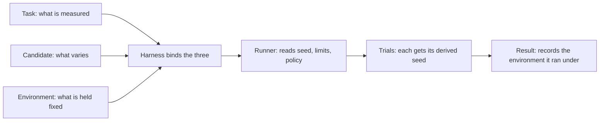

# Environment: what it is and how it grows

Concept note. Today `Environment` holds one setting, the base seed, with `seed_for` to derive a seed per trial (see the [architecture spec](architecture.md)). Everything else in this note is **planned or open**, and says so. Terms are defined in the [glossary](../glossary.md#component-glossary).

## 1. The idea

A harness run is an experiment. In an experiment you change one thing, hold everything else still, and measure:

| In an experiment | In the harness | |
|---|---|---|
| What you change (independent variable) | **Candidate** | An agent, a model, a prompt, a pipeline |
| What you hold constant (controlled variables) | **Environment** | The seed, the limits, how failures are treated, what is pinned |
| What you measure, and on what | **Task** (inputs now; scorers later) | The cases and how they are judged |

So an **Environment** answers one question: *under what fixed conditions did this run happen?* Two results are comparable only if they came from the same environment, and a run is repeatable only if its environment is known. That is the whole reason it exists.

## 2. How agentic harnesses use environments (RL-like, without RL)

Many agentic harnesses borrow the *shape* of a reinforcement-learning environment without being RL frameworks: an agent acts on a stateful world, gets an observation back, and repeats until it finishes or runs out of budget. Nothing is learned. A verifier scores the outcome once at the end, and an episode is what we call a trial. In these harnesses the environment is **the world the agent acts in**, not the machine it runs on. (In plain infrastructure the word means a container image, which is a different thing and a source of confusion.) The details are from each project's docs and papers, read through search results, not from source code.

| Harness | What the agent acts on (the world) | How it acts, and what it sees | Who scores |
|---|---|---|---|
| **DA-Code** (data science) | A Docker Linux environment with Python, SQL, Conda and database engines | Combined write-and-run actions: Bash, Python and SQL, plus a terminate action; it sees the output | Per-task evaluation (the sources I read do not detail it) |
| **Spider2-V** (data science and engineering) | A real computer environment running 20 enterprise applications, set up automatically per task | Code and GUI operations | A metric written for each task |
| **DSGym** (data science) | A container with the task's data files and libraries, run by a manager and workers; reportedly a persistent kernel keeps variables between steps | The agent writes code and reads its output (a CodeAct-style loop); time limits per code run and per task | A metric defined in the task (data files, a query, a metric); the framework also generates training data |
| **Jupyter-based agents** (AG2's Jupyter executor, Hugging Face Jupyter Agent) | A live notebook kernel: variables and imports persist between executions | The agent submits cells and reads their output | The harness around it |
| **OpenHands** (general software agents) | A Docker sandbox with a bash shell, a browser and an IPython server | The agent emits an action; the runtime executes it and returns an observation; both are recorded in an event stream | The harness that uses it |
| **SWE-agent** (software engineering) | A repository in a computer environment, reached through a purpose-built agent-computer interface | A thought and a command per step; short feedback goes back. The interface is designed for the model: a fixed-size file viewer, and edits rejected if they do not parse | The benchmark's tests (SWE-bench) |
| **OSWorld** (computer use) | A real desktop VM set up from a task config: an instruction and setup commands | `reset(task)` returns the first observation and `step(action)` is a mouse or keyboard action, a Gym-style API on a benchmark; it sees a screenshot, an accessibility tree, or both | An evaluator function run on the final state |
| **Harbor, Terminal-Bench** | A sandbox per trial (`start`, `exec`, `upload`, `download`, `stop`) | The agent runs commands inside it | A verifier script writes the reward after the agent stops |
| **Inspect AI** | A sandbox that a task names, such as Docker, with tools like `bash()` and `python()` that run inside it | A solver or agent loop calls the tools; the model is chosen at run time | The task's scorer |

**What they have in common**

1. **The task sets up the world.** Data files, an instruction and setup commands define the starting state.
2. **State persists across steps.** Files and kernel variables carry over, as for a person working in a notebook.
3. **The agent acts through a narrow interface** (run code, a shell command, a GUI action) and gets observations back.
4. **Budgets end the episode:** a step cap, a time limit per action, a total time limit.
5. **A verifier the agent cannot reach does the scoring**, often with hidden labels.
6. **Each episode starts fresh**, in a new container or a reset state, so trials do not contaminate each other.
7. **The agent is separate from the environment.** DSGym ships a default agent and lets others replace it; OpenHands separates the agent from a runtime that turns actions into observations.
8. **The environment's interface shapes the result.** SWE-agent's designed interface solved 18.00% of SWE-bench Lite against 11.00% for a plain shell, with the same model.

### What this means for ours

| Agentic term | Our term | Status |
|---|---|---|
| Agent | **Candidate** | Implemented |
| Episode | **Trial** | The Runner runs one per input |
| Task spec: starting state, goal, verifier | **Task** and its scorers | Task implemented (inputs and optional references); `Scorer` implemented (minimal) |
| Verifier, evaluator | **Scorer** | Implemented (minimal): plain functions `fn(output, reference)` |
| The world: sandbox, tools, persistent state | **Sandbox**, reached by the candidate through `TrialContext` | Planned |
| Step and time budgets; the seed | Run conditions, which is our `Environment` | Seed only |

So our `Environment` holds the rules and budgets of an episode, while the *world* the agent acts in has no home under that name. The name now conflicts with two outside meanings: the container or stack, and the world the agent acts in. An agentic data science candidate also needs a way to reach the world, which `TrialContext` is meant to provide, but today a candidate is a black box, `run(input) -> output`, and the harness cannot see its steps. See open questions 8 and 9.

## 3. What it is not

The word "environment" is easy to read as "the place the code runs". Here it is not.

| Term | What it is | How it differs from Environment |
|---|---|---|
| **Sandbox** (planned) | The place a candidate executes: a working directory, a container | Mechanism, with behavior (`start`, `exec`, `stop`). The environment may *name* which sandbox to use; the sandbox does the work |
| **Runtime** (L3, planned) | Where and how trials are scheduled: local, a cluster | Execution machinery, not run conditions |
| **Task** | What is measured | The environment is how it is measured, not what |
| **Candidate** | What is measured | The thing that varies between runs; the environment must not |
| **HarnessConfig** | Settings that identify and configure a harness (its name, fields a subclass adds) | A harness is one thing and an environment is another; they are built and recorded separately (open question below) |
| **`Experiment`** (`velari_core`) | Project-level bootstrap: output directories, `.env`, seeding the global random state | Convenience for a project. The environment is a plain value that is recorded with a result |
| **Harness** | Binds a task, a candidate and an environment and runs them | The environment is one of its three inputs |

Note that Harbor and MLE-bench use "environment" for the *place* code runs (a container). That is what we call the Sandbox. The name collision is real; see section 9.

## 4. In one line each

- **Task** is the question, **Candidate** is who answers, **Environment** is the rules of the exam, **Sandbox** is the room, **Runner** is the invigilator, **Result** is the answer sheet.

## 5. Why it is separate

1. **It varies independently.** The same task and candidate run under different environments tell you how sensitive a result is: five seeds give a spread, a stricter time limit shows what the candidate does under pressure.
2. **Fairness.** Every candidate in a comparison must get the same conditions. Passing one environment to all of them makes that a property of the design, not a habit. A candidate cannot opt out of a limit.
3. **Record and replay.** A result that stores its environment says exactly how it was produced. Without that, "42 versus 43" or "30 s versus 60 s" differences hide inside unexplained score differences.

## 6. How the layers use it

Only the first row exists today.

| Component | Reads from the environment | Status |
|---|---|---|
| Per-trial seeds | `seed`, through `seed_for(key, trial)` | Implemented; nothing calls it yet |
| **Runner** | Seed for each trial (handed to the candidate through `TrialContext`); time limit per trial; error and retry policy; fail-fast and error ratio; where artifacts go | Planned |
| **Harness** | Holds the environment together with a task and a candidate, and passes it to the Runner | Planned (open question Q7) |
| **Result / store** | Records the environment (or a hash of it) in the result's spec, so comparisons can check that two runs match | Planned |
| **Comparison** (later) | Refuses or warns when two results have different environments | Planned |
| **Evaluation category** | Adds token, message and cost limits; pins judge model and generation parameters | Planned (subclass) |
| **Data science category** | Adds the dataset snapshot id, library versions, hardware policy | Planned (subclass) |
| **Runtime layer (L3)** | Chooses a sandbox (local, container, cloud) from a named setting | Planned |
| **Config** | The `environment:` section of an OmegaConf config builds it, the same way `HarnessConfig` is built | Planned |

## 7. How it grows

Each step is a candidate increment, not a commitment.

| Step | Adds | Used by |
|---|---|---|
| Today | `seed`, `seed_for` | Nothing yet |
| Next | A per-trial time limit; error and retry policy; fail-fast and error ratio | The Runner (it would start taking an `Environment`) |
| Then | An artifacts directory; recording the environment in a `Result` | Runner, store |
| Applied | Subclasses with domain settings: token and cost limits, pinned model parameters; dataset snapshot, library versions | Evaluation and data science categories |
| Later | Naming a sandbox | The runtime layer |

Growth by **subclassing**, the way a category adds settings with a `HarnessConfig` subclass, keeps the core free of domain terms.

## 8. Design rules

- **Declarative data, not behavior.** An environment states conditions; other components act on them.
- **Immutable.** It must not change during a run. (`Environment` is a frozen dataclass.)
- **Serialisable.** It must be recordable in a result and rebuildable from config.
- **Same for every candidate** in a comparison.
- **No global side effects.** It never seeds or reads global random state. A candidate that needs the global stream seeds it from its own trial seed.
- **Extended by subclassing,** not by adding domain fields to the core class.
- **It selects a sandbox but is not one.**

## 9. Open questions

1. **The name.** "Environment" collides with Harbor's meaning (the place code runs). Alternatives that say "fixed conditions": `RunConditions`, `RunSettings`, `Conditions`. Deferred, like the name `Task`; record it and decide when the Runner starts using it.
2. **Boundary with `HarnessConfig`.** Does the harness config contain an `environment:` section, or are they separate objects built side by side?
3. **Per run or per trial.** One environment for the whole run is assumed. Whether a trial may override a condition (a longer limit for one input) is undecided.
4. **Relation to `Experiment`.** Should an environment take its seed or artifacts directory from an `Experiment` when one exists, and should it ever seed the global generators for legacy candidates?
5. **Shape of limits.** Flat fields on the environment, or a nested `Limits` object that categories extend?
6. **What gets recorded.** The full environment in each result, or a hash plus a copy in the run's metadata.
7. **When to connect.** Whether the next increment is the Runner reading an `Environment`, or the Harness holding one first (Q7).
8. **Scope and name of `Environment`.** In agentic harnesses (DSGym, DA-Code, Spider2-V, OpenHands, OSWorld) the environment is the stateful world the agent acts in: a sandbox, tools, a starting state set by the task, budgets, and a seed passed at reset. Ours is the run conditions. Either rename ours (for example `RunConditions`) and let "Environment" mean the world, or widen ours to be the world together with its conditions, with the Sandbox as the mechanism.
9. **Who drives the loop.** In some harnesses the framework runs the step loop: DSGym provides the loop and a default agent and lets others plug in, and OpenHands separates the agent from a runtime that executes its actions. In others the agent owns the loop. Our `Candidate` is a black box, `run(input) -> output`, which suits an agent with its own loop but hides its steps. Whether the harness should expose step-level interaction (actions and observations) is open.
